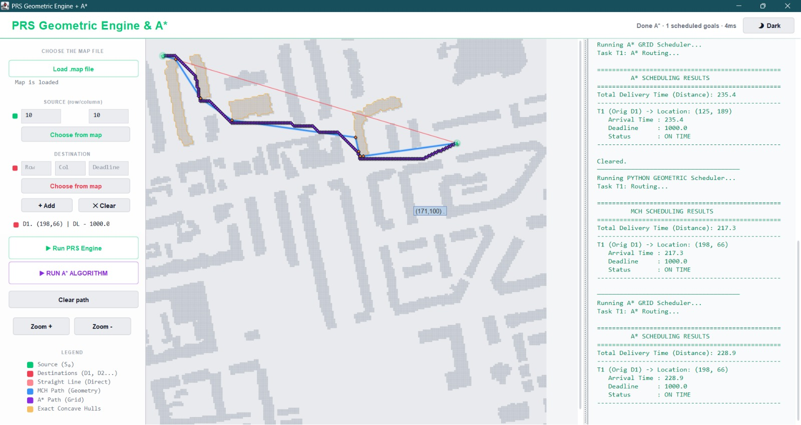
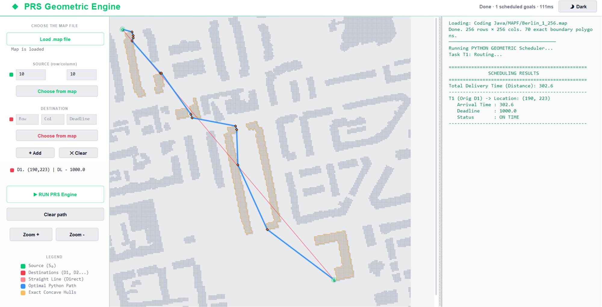

# Drone Delivery with Deadlines

**Hybrid Zone-Based Multi-Token Routing in Obstructed Airspace**

This final-year team project explores deadline-aware pickup-and-delivery task assignment and route planning for a simulated drone fleet. The Java code includes command-line workflows and Swing visualizations. It is a software simulation project; it does not control physical drones.

## Project screenshots

The screenshots below show the routing interface and sample simulation outputs.

### Routing algorithms and scheduled-goal results

The interface displays obstacle-aware routes and results from PRS, A*, and MCH scheduler runs.



### Berlin map route run

A sample run on a 256 × 256 Berlin map. The results panel reports 70 exact boundary polygons and a delivery distance of 302.6, marked on time for the displayed deadline.



## Approach

- **Hybrid Zone-Based Multi-Token Passing (HZ-MTP):** partitions the work area into zones and uses localized token coordination to assign delivery tasks.
- **Deadline and proximity scheduling:** prioritizes delivery deadlines while considering task and drone locations.
- **Perimeter Extraction, Recursive Subdivision, and Smoothing (PRS):** the report describes a geometric route planner that checks obstacle perimeters, inflates obstacles with a safety margin, and smooths detour paths.
- **Comparisons:** the project materials compare PRS with A* for route lengths and compare multi-token with single-token task assignment.

## Reported simulation result

For the 100-task workload on a 1024 x 1024 Berlin map, Table 11 of the report records **96 completed tasks with the proposed multi-token approach** and **50 with single-token passing**. The report lists 4 and 50 pending or expired tasks, respectively. This is a reported simulation scenario, not a field test.

## Benchmark workbooks

Both workbooks compare PRS and A* path lengths across five map scenarios: Berlin 256 x 256, Berlin 1024 x 1024, Boston 1024 x 1024, London 1024 x 1024, and Milan 1024 x 1024.

- [100-iteration benchmark](benchmarks/benchmark-100-runs-five-maps.xlsx): 100 source-destination runs per map scenario.
- [1,000-run benchmark](benchmarks/benchmark-1000-runs-five-maps.xlsx): 1,000 source-destination runs per map scenario.

See [benchmark notes](benchmarks/README.md) and the [project report](docs/project-report.pdf) for context and methodology.

## Run the Java demo

Install a Java Development Kit, then from the repository root:

```bash
javac -d build src/*.java
java -cp build Demo
```

The interactive task-assignment menu can be launched with:

```bash
java -cp build job
```

The Swing routing interfaces are `MCHRouteGUI` and `MCHRouteGUI_WithAStar`. They expect a compatible map file to be selected; map files are not included in this repository.

## Repository layout

- `src/` - Java application, simulation, and routing sources.
- `tests/` - Java verification programs supplied with the project.
- `benchmarks/` - path-comparison workbooks.
- `examples/` - sample inputs and output logs for task and token scenarios.
- `docs/` - academic report and quickstart.

## My contribution

I co-designed the Hybrid Zone-Based Multi-Token Passing approach. The report contains the full team methodology and project details.

## Project report

[Read the full report](docs/project-report.pdf).
